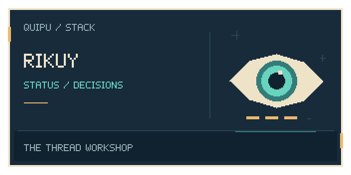

<p align="center"></p>

<h1 align="center">rikuy</h1>
<p align="center"><em>👁 Keep status, graphs, watches and decisions in view</em></p>
<p align="center"><a href="LICENSE">Apache-2.0</a> · <a href="https://github.com/intigraph/rikuy/actions/workflows/ci.yml">CI</a> · <a href="docs/book/src/introduction.md">Docs</a> · <a href="https://github.com/intigraph/tambo">Quipu stack</a></p>

**Rikuy is a browser brief for people who run agents on Quipu.** It shows what
is being worked on, what shipped and what is waiting on you, and it lets you
answer with a signed decision. It is a static site. It stores nothing of its
own and reads only the Quipu graph you point it at. Rikuy means "to see" in Quechua.

**Where it stands (v0.4.0).** The demo, the build and the job-cost report work
today. Live reads and signed decisions are written and tested, but they ship
switched off. Each deployment turns them on after its own checks.
[Implementation status](docs/book/src/status.md) lists every part.

## What it does today

| Part | What you get | State |
|---|---|---|
| **Today brief** | Six tabs: Today, Next, Pace, Board, Log and Explore. A panel without verified data says *Unavailable*, never zero. | Runs on sample rows in the demo. Live reads are off by default. |
| **Asks** | Each question waiting on a person is a card: the options, the recommended one, what happens if nobody answers, the deadline, and the work it unblocks. | Read-only cards are built. Answer buttons need signing turned on. |
| **Signed decisions** | Answer a card with a passkey. Quipu checks the signature and records the answer in one step. A stale, forged or replayed answer is refused. | Built and tested against throwaway local stores. Off by default. |
| **Settlement into Seeds** | Choosing an option closes the Ask and writes the ruling onto the work item it unblocks. | Built. Needs a separately admitted Seeds port. |
| **Passkey enrollment** | A page that creates a passkey and shows its public key and fingerprint, for an operator to register by hand. | Built. Off by default. |
| **Graph explorer** | Click through a dated snapshot of the graph in the page, using Quipu compiled to WebAssembly. | Built. A public build carries no snapshot; a deployment supplies one. |
| **Pull requests and watches** | Open pull requests by state with the oldest age, and scheduled watch reports. | Built. Off by default. |
| **Job economics** | Counts, retries, durations and budget endings for short agent jobs, from a ledger snapshot you load yourself. | Works today. Makes no network request. |
| **Offline decisions** | Decide without a connection and send when you are back online. | The page and its outbox are built. The server side is not. |
| **Repository pendant** | Each release publishes a small Quipu share that describes this repository, with a checksum and provenance. | Published with v0.4.0. |

## What is planned

In order. Only the Asks row has a date in the [stack roadmap](https://github.com/intigraph/.github/blob/main/ROADMAP.md).

| When | Planned |
|---|---|
| **Next** | **Live reads in a real deployment:** register the exact stored queries, measure what they cost, then switch the readers on. |
| | **A fuller Pace tab:** merges, releases and closes beside deploys. The queries are written but not yet shown. |
| **Later** (March to May 2027) | **Asks, end to end:** a one-tap card with a default and an expiry, signed from a phone and settled into Seeds. |
| **Direction** | **An operator command center:** delivery measures (deploy frequency, lead time, change failure rate, time to restore), throughput, and open against closed work over time. |
| | **A notice to the crew's administrator** whenever the operator acts through the brief. |
| | **Offline decisions** delivered end to end, and a checksummed release package. |

## Install

```sh
curl -fsSL https://raw.githubusercontent.com/intigraph/rikuy/main/install.sh | sh
```

Needs Node 22+, npm, Python 3 and Git. The installer builds the current `main`
from source and copies the static files to `~/.local/share/rikuy/REVISION`.
It starts no server and sets up no connection or credentials. Serve that folder
with any static web server. There is no prebuilt, checksummed package yet.
[Installer options, manual builds and removal](docs/book/src/reference.md#installing-and-removing).

## First success in three commands

```sh
git clone https://github.com/intigraph/rikuy.git
cd rikuy
just demo
```

```text
Validated demo: 2 priorities and 1 decision.
Rikuy demo: http://127.0.0.1:4173
```

Open that address. The brief shows checked sample rows: one decision under
*Needs you* and two priorities under *Next*. Nothing is read from Quipu and
nothing is signed. The newer Today page is at `/today/`; with no live source
connected, each of its panels says *Unavailable*. Stop the demo with Ctrl-C.

<p align="center"></p>

The recording builds the real client and checks the sample rows. It also shows
a row from the wrong source being refused. [Reproduce it](docs/demos/terminal.md).

## On your own data

| You want to | Start here |
|---|---|
| Know what works and what is switched off | [Implementation status](docs/book/src/status.md) |
| Point the brief at your own graph | [Configuration](docs/book/src/reference.md#configuration) |
| Understand how a signed decision is made | [Signed decisions](docs/book/src/signed-decisions.md) |
| Load the job-cost report | [Ephemeral job economics](docs/ephemeral-economics.md) |

The [latest release](https://github.com/intigraph/rikuy/releases/latest) includes a
repository pendant, its checksum and its provenance. Verify them together, then use
`quipu import SHARE_DIR --db repository.db`. Import stages the knowledge and leaves
ROOT unchanged. Follow the [verified import workflow](https://intigraph.github.io/quipu/sharing/index.html).

## Wire it into your agent

There is nothing to wire. Rikuy is a page for people, not an MCP server or an
agent harness. Agents write knowledge and work items to Quipu through
[Camayoc](https://github.com/intigraph/camayoc) and
[Seeds](https://github.com/intigraph/seeds). Rikuy reads the graph and named
queries a deployment has admitted. [Using it with agents](docs/book/src/agents.md).

## Before you start

| For | You need |
|---|---|
| Build and tests | Node 22+ and [just](https://github.com/casey/just) |
| The browser | ES modules, WebAssembly and workers. A current Chrome, Firefox or Safari will do. |
| Live reads | A Quipu server, an admitted graph and the exact named queries. Credentials stay on the server. |
| Signed decisions | Quipu's attested writes switched on, a dedicated HTTPS origin and an enrolled passkey |

- Never put a bearer token, a private key or an operator snapshot in the built site.
- Delivering source turns nothing on. Readers, signing and enrollment are each
  admitted separately by whoever runs the deployment.

## What's next

- [The Rikuy book](docs/book/src/introduction.md): start here to go deeper.
- [Implementation status](docs/book/src/status.md): what is live, what is off and what is missing.
- [How it works](docs/book/src/how-it-works.md): the routes, the data flow and why everything starts off.
- [Docs map](docs/book/src/docs-map.md): every document in this repository.
- [Stack roadmap](https://github.com/intigraph/.github/blob/main/ROADMAP.md): what is planned across the stack.

## 🧺 The stack

Tambo installs these together and proves each one works; every tool also stands alone.

<!-- stack-table:start -->

The Quipu stack is built around a governed, bitemporal knowledge store: shared
facts, decisions and work history your agents can query. Quipu can check writes
against your rules, records where each fact came from, and answers what was true
when.

| tool | what it gives your agents |
|---|---|
| [tambo](https://github.com/intigraph/tambo) | 🧰 Agent Platform Toolkit - installs and configures the quipu stack |
| [quipu](https://github.com/scbrown/quipu) | stores shared facts with provenance and history; can check writes against your rules |
| [camayoc](https://github.com/scbrown/camayoc) | prepares knowledge and vocabulary for Quipu, with checks before it is admitted |
| [quechua](https://github.com/scbrown/quechua) | shared vocabulary and shapes for interoperable knowledge |
| [chaski](https://github.com/scbrown/chaski) | reacts to graph changes and delivers governed notifications |
| [bobbin](https://github.com/scbrown/bobbin) | indexes your codebase and injects context from that index and Quipu knowledge |
| [yupana](https://github.com/scbrown/yupana) | shows code impact and can read policies from Quipu to govern agent actions |
| [desire-path](https://github.com/scbrown/desire-path) | turns agent mistakes into feature requests; works on its own without Quipu |
| [seeds](https://github.com/scbrown/seeds) | a work item tracker backed by the Quipu knowledge base |
| [shantytown](https://github.com/scbrown/shantytown) | runs crews of AI agents on work items, triggered by hand, on a schedule or by events; can share work and memory through Quipu |
| [rikuy](https://github.com/scbrown/rikuy) | live brief: status, graphs, watches and signed decisions over Quipu |
| [shuttle](https://github.com/scbrown/shuttle) | runs signed agent workflows and keeps their records in Quipu |

<!-- stack-table:end -->

## Contributing

```sh
just build
just test
just ci
```

Browser checks need an installed browser. Set `RIKUY_BROWSER_EXECUTABLE` to its
path, or install Playwright Chromium yourself. Local test commands never install
browsers or system packages; hosted CI sets up its own throwaway runner first.

See [CONTRIBUTING.md](CONTRIBUTING.md) and [AGENTS.md](AGENTS.md).

## 📜 License

Apache-2.0. See [LICENSE](LICENSE) and [NOTICE](NOTICE).
