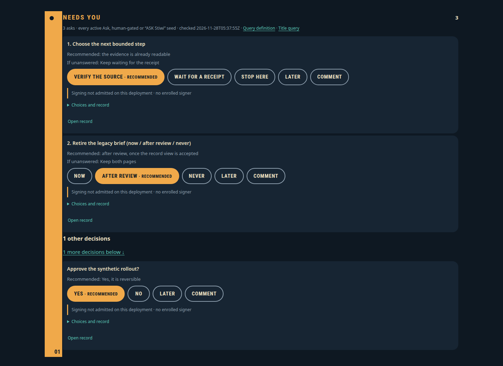
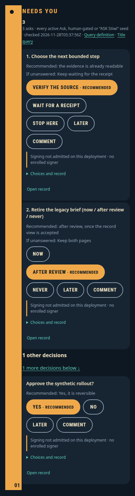
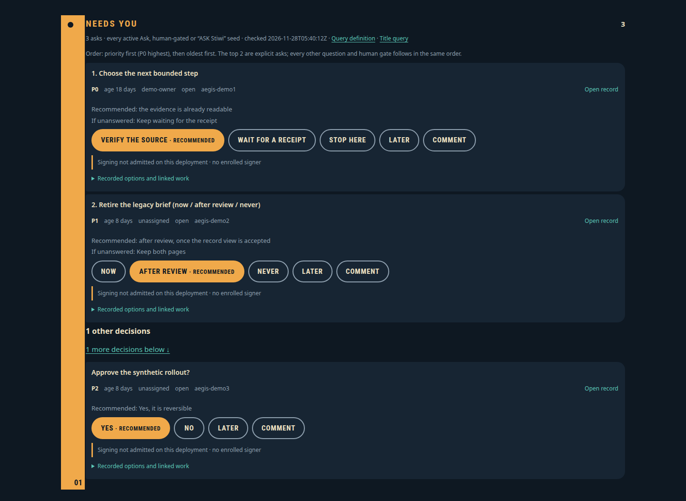
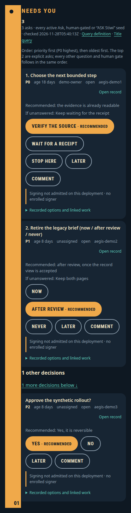

# Needs-you cards: metadata inline, no trailing gap

Captured from `just demo` at `/today/demo-asks/` (synthetic rows, nonlocal requests blocked),
at 1440×1000 and 412×915, before and after the change.

| | Desktop | Phone |
|---|---|---|
| Before |  |  |
| After |  |  |

Before: priority, age and owner sat inside the collapsed disclosure, and a lone
Open record button left a blank band at the bottom of every card. Nothing said
how the cards were ordered.

After: each card has a metadata line under the title (priority, age, owner,
status, id) with Open record on the same line. The choices stay inline and
disabled with the signing reason. The disclosure holds only the recorded
options, deadline and linked work, and the panel header states the ordering rule.
