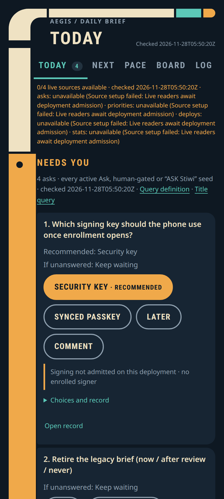
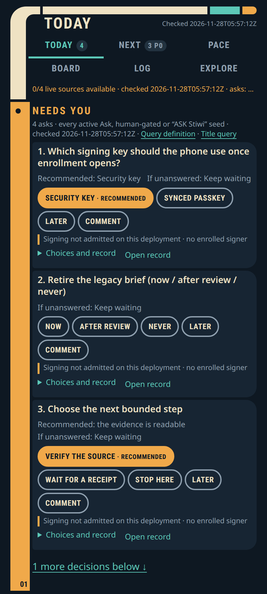
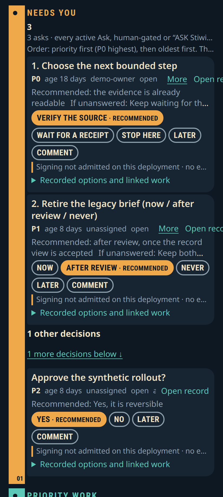
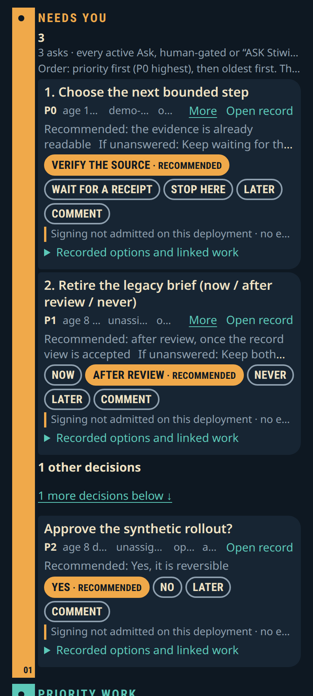
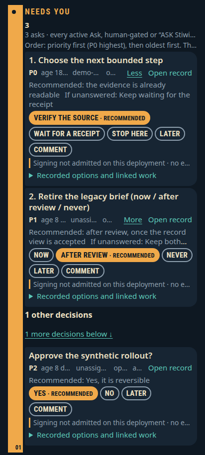
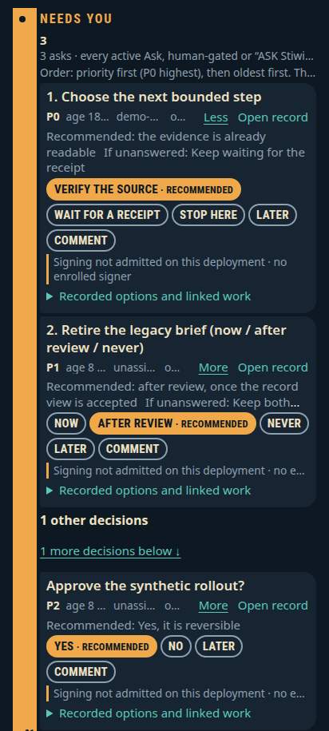

# Today on a 412x915 phone

Captured from `just demo` (`/today/`, live readers off) in Chrome mobile
emulation at 412x915, device scale 2, reduced motion. Four synthetic Asks and
three synthetic P0 rows are rendered in the page through `home-view.mjs`, the
same way `scripts/test-today-look-browser.mjs` does; no request leaves the page.

| Measure at 412x915 | Before | After |
| --- | --- | --- |
| Tabs clipped | Log, Explore (behind a hidden horizontal scroll) | none: six tabs in a 3x2 grid |
| Page status line | 7 lines (2 with live readers) | 1 line, full text on focus or tap |
| Asks with choices on the first screen | 1 | 3 |
| P0 count on the first screen | no (at y=1766) | yes: `3 P0` badge on the Next tab |
| `document.scrollWidth` | 412 | 412 |

 

Desktop layout is unchanged: the compact rules apply at 600 px and below.
`askDecisionsEnabled` stays false; every choice still renders disabled with its reason.

The CI browser may lack the condensed console fonts. With every font forced to
the wider DejaVu Sans, the third Ask choices still end at y=839 of 915.

## Wider fonts: the Ask meta line

On the CI runner the meta line under each Ask (priority, age, owner, status,
More, Open record) did not fit at 390 px, so Open record pushed the page 8 px
wider than the screen. The text fields on that line now give way with an
ellipsis (id first, priority never), and each keeps its full value as a
tooltip. `scripts/test-today-browser.mjs` repeats its no-horizontal-scroll
check at a 125% root font with wider letter spacing, so the check does not
depend on which fonts are installed.

Captured from `just demo` at `/today/demo-asks/`, 412 px wide, root font 125%:

| | `document.scrollWidth` |
| --- | --- |
| Before | 448 (Open record cut off at the right edge) |
| After | 412 |

 

## Signing reason on a phone

At 412 px the signing reason under the choices is one line, so it can be cut off. Earlier, tapping **More** expanded only the question and its Why lines, and the full reason was available only as a `title` tooltip, which touch screens never show. Now **More** also appears when only the reason is cut off, and expands the reason in place. Taken with `just demo` at `/today/demo-asks/`, 412x915, root font 125%, after tapping **More** on the first card:

| Before | After |
| --- | --- |
|  |  |
